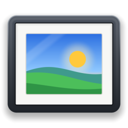

<p align="center">
  
</p>

<h1 align="center">qslides</h1>

<p align="center">Фоторамка на рабочем столе: слайд-шоу картинок и видео без звука из ваших папок</p>

<p align="center">
  <a href="https://github.com/Fan4Metal/qslides/releases/latest"></a>
  
  
  <a href="LICENSE"></a>
</p>

<p align="center"><a href="README.md">English</a> | <b>Русский</b></p>

qslides — небольшой виджет для рабочего стола Windows, работающий как фоторамка. В его библиотеку добавляется несколько папок, и виджет показывает слайд-шоу картинок и видео, найденных в них и во всех вложенных папках. Видео воспроизводится без звука. У окна нет рамки и заголовка: оно перемещается перетаскиванием картинки, меняет размер за края и управляется через меню правой кнопки мыши. Картинки и видео декодируются кодеками самой Windows, поэтому программа состоит из одного исполняемого файла.

## Возможности

- **Библиотека папок**: любое число папок, просматриваемых вместе со всеми вложенными (см. [Библиотека](#библиотека)).
- **Картинки и видео**: JPEG, PNG, GIF, BMP, TIFF, JPEG XR, а также HEIC, AVIF и WebP при установленных расширениях из Microsoft Store; MP4, MOV, MKV, AVI, WMV, WebM и другие видео, которые воспроизводит Windows, без звука.
- **Параметры слайд-шоу**: время показа слайда (от 1 секунды до часа), порядок (по имени, по дате, случайно), картинки, видео или и то и другое, картинка целиком или на всё окно, видео столько же, сколько картинки, своё время или целиком, более длинное видео несколькими кусками, подпись с папкой, именем файла и датой съёмки, включаемыми по отдельности (см. [Слайд-шоу](#слайд-шоу)).
- **Окно без рамки** с предустановками пропорций от 16:9 до 9:16, сохраняемыми при изменении размера.
- **Запуск вместе с Windows, поверх всех окон или на рабочем столе под всеми окнами, только в трее**: каждый — один переключатель меню; поверх всех окон виджет уступает полноэкранным программам.
- **Тихая работа**: между слайдами программа ничего не делает; следующий слайд декодируется заранее, слайды сменяются с коротким растворением. Пока компьютер заблокирован или экран выключен, показ стоит.
- **Английский или русский интерфейс**: следует языку Windows, меняется в окне «О программе» (`F1`).
- **Портативность**: [портативный архив](#установка) хранит настройки рядом с программой.
- **Конфиденциальность**: никаких обращений к сети, кроме необязательной проверки обновлений (см. [Проверка обновлений и конфиденциальность](#проверка-обновлений-и-конфиденциальность)).

## Установка

Установщик и портативный архив публикуются на странице [Releases](https://github.com/Fan4Metal/qslides/releases).

Установщик `qslides_<версия>_Setup.exe` не требует прав администратора: программа помещается в `%LOCALAPPDATA%\Programs\qslides`. Установленная программа хранит настройки в `%APPDATA%\qslides`. При удалении программа убирается и из списка автозагрузки Windows.

Портативный архив `qslides_<версия>_portable.zip` содержит программу в папке `qslides` и работает без установки. В нём также лежит пустой файл `app.ron`: пока он находится рядом с `qslides.exe` и папка доступна для записи, настройки и библиотека хранятся рядом с ним, так что программу можно носить на съёмном диске. Без этого файла они хранятся в `%APPDATA%\qslides`, как у установленной программы. Окно «О программе» показывает, где хранятся настройки.

Исполняемые файлы не подписаны, поэтому Windows SmartScreen при первом запуске может предупредить о неизвестном издателе.

## Использование

Окно показывает текущий слайд на чёрном фоне. Перетаскивание картинки перемещает окно, перетаскивание краёв и углов меняет его размер. Когда указатель движется над окном, внизу появляются кнопки **Предыдущий**, **Пауза** и **Следующий**, в левом верхнем углу — **Открыть файл** (в программе, связанной с ним в Windows) и **Показать в папке** (в Проводнике), а в правом верхнем углу — крестик, закрывающий программу; через несколько секунд они снова исчезают. Двойной щелчок открывает показанный файл в программе, связанной с ним в Windows.

Всё остальное — в меню правой кнопки мыши. Щелчок по значку в трее выводит виджет поверх других окон; правая кнопка на значке в трее открывает короткое системное меню: **qslides** делает то же самое, **Выход** закрывает программу. Меню виджета — небольшая панель в собственном окне, поэтому оно выходит за края маленького виджета; у краёв экрана оно открывается влево или вверх. Меню закрывается щелчком в другом месте или клавишей `Esc`; настройки в нём действуют сразу и меню не закрывают.

| Часть | Что делает |
|---|---|
| Кнопки вверху | **Предыдущий**, **Пауза**, **Следующий** и номер показанного файла из числа всех файлов показа (`12 / 340`); справа **О программе qslides** (`F1`: версия, язык, проверка обновлений) и крестик, закрывающий меню |
| **Время показа** | Ползунок времени, которое держится слайд, от 1 секунды до 1 часа |
| **Порядок** | **По имени**, **По дате**, **Случайно** |
| **Показывать** | **Картинки**, **Видео**: каждый вид включается и выключается отдельно, хотя бы один остаётся включённым |
| **Картинка** | **Вписать целиком** или **Заполнить окно** |
| **Видео** | **Длина**: как картинки, от 10 секунд до 1 часа или целиком; **Кусками**: от 1 до 10 |
| **Подпись** | **Папка**, **Имя файла**, **Дата съёмки**: каждая часть включается и выключается отдельно, включённые выводятся вместе в левом нижнем углу слайда |
| **Пропорции окна** | **Произвольные**, 16:9, 16:10, 3:2, 4:3, 5:4, 1:1, 4:5, 3:4, 2:3, 9:16 |
| **Папки** | Библиотека: каждая папка с кнопками открытия в Проводнике и удаления из библиотеки, **Добавить папку…**, **Найти новые файлы** |
| **Поверх всех окон** | Окно остаётся над другими окнами; с пунктом **Не поверх полноэкранных программ** (включён по умолчанию) оно уходит под полноэкранную игру, фильм или презентацию на своём экране, пока та впереди, и возвращается поверх остальных, когда она закрывается или активируется другое окно |
| **На рабочем столе, под всеми окнами** | Окно остаётся под другими окнами, как картинка на рабочем столе |
| **Запускать вместе с Windows** | Программа запускается при входе пользователя в систему |
| **Только в трее** | Нет кнопки на панели задач; вместо неё значок в области уведомлений |
**Поверх всех окон** и **На рабочем столе** исключают друг друга. На рабочем столе щелчок по окну не выводит его вперёд; это делают щелчок по значку в трее или повторный запуск программы — до тех пор, пока не активируется другая программа.

Одновременно работает только одна копия программы: повторный запуск выводит вперёд уже открытое окно.

### Библиотека

Папки добавляются пунктом **Папки → Добавить папку…** (`Ctrl+O`) или перетаскиванием на окно; файл, перетащенный на окно, добавляет свою папку. Библиотека просматривается при запуске, после каждого изменения и по пункту **Найти новые файлы** (`F5`). Скрытые и системные папки, ссылки и точки соединения пропускаются. Папка библиотеки, лежащая внутри другой, не добавляет файлы повторно. Папка, которую не удаётся прочитать, например на ещё не подключённом сетевом диске или на извлечённом носителе, выделяется в меню цветом предупреждения и проверяется снова несколько раз в течение четверти часа; **Найти новые файлы** проверяет её сразу.

<details><summary>Где хранится библиотека</summary>

Папки перечислены по одной в строке в файле `library.txt` рядом с файлом настроек: в `%APPDATA%\qslides\data` у установленной программы, рядом с `qslides.exe` у портативной. Файл можно править в Блокноте: читаются UTF-8, UTF-16 и кодовая страница ANSI Windows. Файл, показанный при закрытии программы, запоминается, и при следующем запуске показ продолжается с него.

</details>

### Слайд-шоу

**По имени** показывает папки в том порядке, в каком они добавлены в библиотеку, а внутри каждой — файлы и вложенные папки по имени, как их сортирует Проводник: `2.jpg` раньше `10.jpg`. **По дате** идёт от самого старого файла к самому новому по времени последнего изменения. **Случайно** показывает каждый файл один раз за круг в перемешанном порядке и перемешивает заново для следующего круга. **Показывать** ограничивает слайд-шоу картинками или видео библиотеки; сама библиотека при этом не меняется.

Картинка при декодировании уменьшается до размера экрана и поворачивается по своей ориентации EXIF. **Вписать целиком** показывает её полностью с чёрными полями там, где её пропорции отличаются от пропорций окна; **Заполнить окно** закрывает всё окно и обрезает края картинки.

Подпись выводится в левом нижнем углу слайда и уступает место кнопкам, пока они видны. Её части включаются по отдельности, включённые выводятся одна за другой через точку: **Папка** — имя папки файла, **Имя файла** — имя файла без расширения, **Дата съёмки** — день, когда сделана фотография (по её данным EXIF) или записано видео, как его читает Windows. У файла без такой даты в подписи нет даты; если не включена ни одна часть, подписи нет.

Ползунок **Длина** задаёт время, отведённое видео: столько же, сколько картинке (**как картинки**; более короткое видео начинается сначала), своё время от 10 секунд до 1 часа (более короткое видео показывается один раз) или **целиком**, какой бы длины оно ни было. Видео длиннее своего времени показывается числом кусков, заданным пунктом **Кусками**: время делится между ними поровну, первый кусок берётся из начала видео, последний заканчивается в его конце, остальные расположены равномерно между ними, и каждый кусок переходит в следующий с растворением, как слайды. При одном куске показывается только начало видео. Кусок не бывает короче 2 секунд, поэтому при малом времени кусков может оказаться меньше. Звук видео никогда не воспроизводится. Видео декодируется на видеокарте, когда Windows это позволяет, поэтому видео 4K с телефона идёт плавно; видео декодируется не крупнее, чем нужно окну, а слайд показывает не больше 30 кадров в секунду. Файл, который не удаётся декодировать, пропускается до следующего просмотра библиотеки.

<details><summary>Каким форматам нужны расширения из Microsoft Store</summary>

Windows сама декодирует JPEG, PNG, GIF (первый кадр), BMP, TIFF, ICO и JPEG XR, а также видео H.264, MPEG-4 и WMV. Для HEIC нужны расширения HEIF Image Extensions и HEVC Video Extensions, для AVIF — AV1 Video Extension, для WebP — WebP Image Extensions, для видео VP9 — VP9 Video Extensions. Файлы, которые Windows не может декодировать, пропускаются.

</details>

## Горячие клавиши

| Клавиша | Действие |
|---|---|
| `Вправо`, `Page Down`, колесо вниз | Следующий слайд |
| `Влево`, `Page Up`, колесо вверх | Предыдущий слайд |
| `Пробел` | Пауза или продолжение |
| `Enter`, двойной щелчок | Открыть показанный файл |
| `Ctrl+O` | Добавить папку |
| `F5` | Найти новые файлы |
| `F1` | О программе |

## Проверка обновлений и конфиденциальность

Проверка обновлений необязательна и по умолчанию выключена. Если в окне «О программе» включён флажок **Проверять обновления при запуске (раз в сутки)**, программа не чаще раза в сутки запрашивает у GitHub Releases API (`api.github.com`) последний выпуск; кнопка **Проверить сейчас** в том же окне запрашивает сразу. Запрос не содержит ничего, кроме версии программы в заголовке `User-Agent`, и ничего не скачивается и не устанавливается: если есть более новый выпуск, вверху меню появляется пункт с его версией, открывающий страницу выпуска в браузере. В остальном программа к сети не обращается.

## Сборка

Требования: Windows 10 или новее, стабильный Rust (цель MSVC, редакция 2024) и Visual Studio 2022 Build Tools с компонентом C++. Для `build.py` — [uv](https://docs.astral.sh/uv/).

```
uv run build.py          # target\release\qslides.exe
cargo test
```

`build.py` сначала закрывает `qslides.exe`, запущенный из папки `target` проекта (иначе файл заблокирован), затем выполняет `cargo build --release`. Если программа не запущена, достаточно обычного `cargo build --release`. Исполняемый файл линкует среду выполнения C статически (`.cargo/config.toml`), поэтому ничего, кроме самой Windows, ему не нужно.

## Установщик и выпуск

Скрипт выпуска собирает исполняемый файл, установщик и портативный архив. Для него нужен [Inno Setup 6](https://jrsoftware.org/isinfo.php).

```
python tools/make_release.py              # тесты, сборка, установщик, архив
python tools/make_release.py --no-tests   # то же без cargo test
python tools/make_release.py --install    # затем тихая установка поверх установленной копии
```

Скрипт записывает файлы в `dist`, версия берётся из `Cargo.toml`. Скрипт установщика — `tools/setup.iss`; значок установщика записывает `qslides.exe --export-icon <файл.ico>`.

Выпуски на GitHub собирает workflow **Release** (`.github/workflows/release.yml`). После обновления версии в `Cargo.toml` и коммита достаточно отправить соответствующий тег — будет опубликован выпуск с установщиком и портативным архивом:

```
git tag v0.1.0
git push origin v0.1.0
```

Workflow останавливается, если тег не совпадает с версией в `Cargo.toml`. Ручной запуск (Actions → Release → Run workflow) собирает файлы и прикладывает их к запуску, не создавая выпуска.

## Используемые проекты

qslides построен на следующих проектах с открытым исходным кодом:

- [egui / eframe](https://github.com/emilk/egui): интерфейс и окно;
- [windows-rs](https://github.com/microsoft/windows-rs): Windows Imaging Component, Media Foundation и остальной Windows API;
- [rfd](https://github.com/PolyMeilex/rfd): диалог выбора папки;
- [Inno Setup](https://jrsoftware.org/isinfo.php): установщик.

## Лицензия

MIT, см. [LICENSE](LICENSE).
